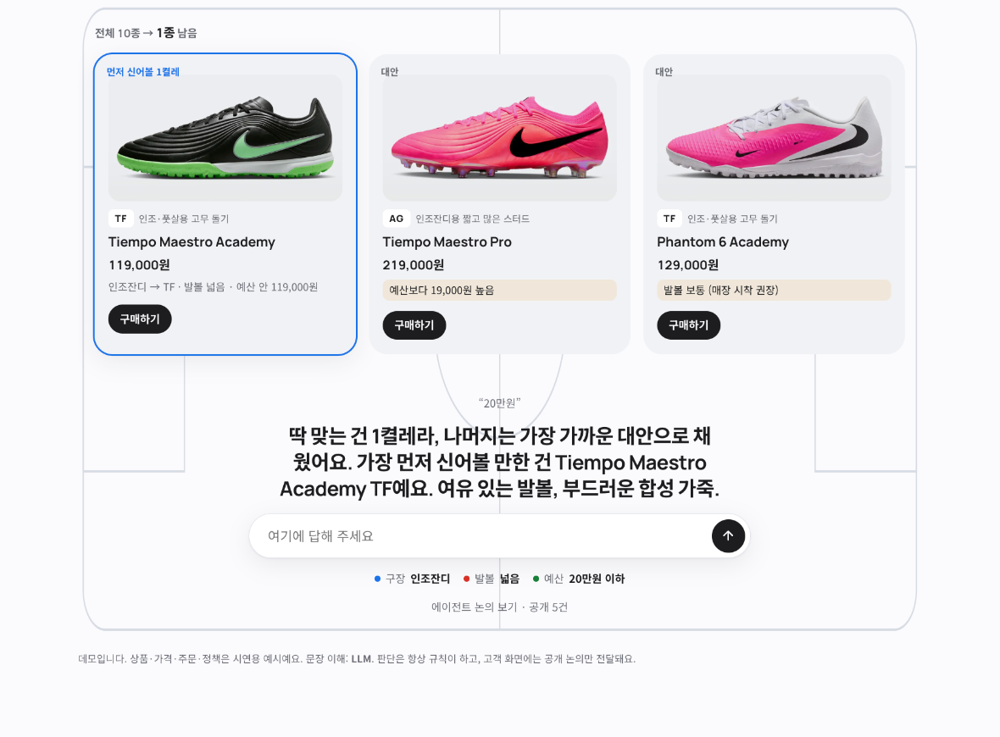
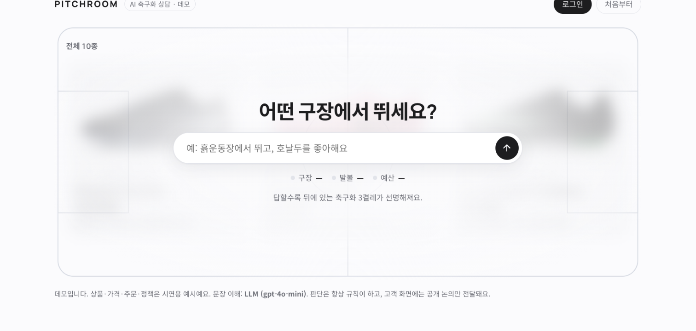
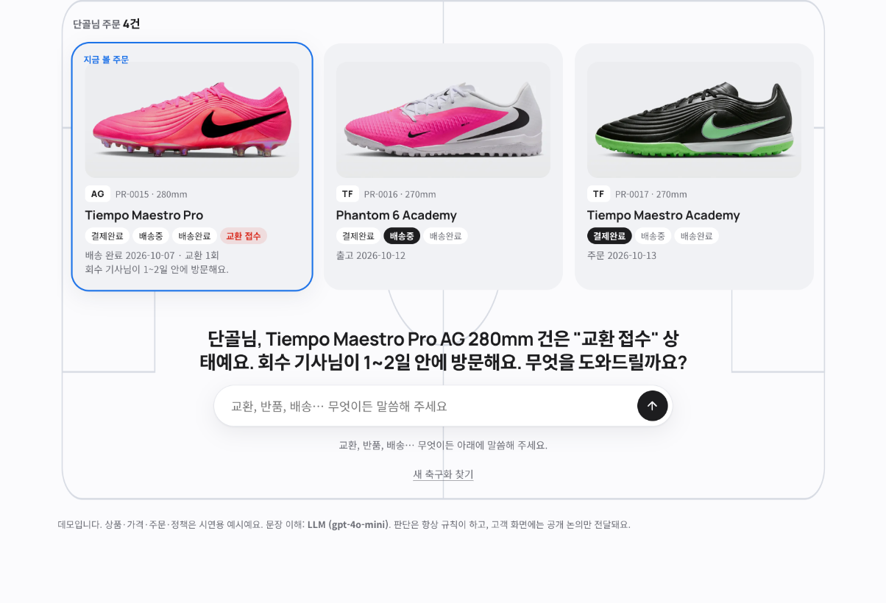
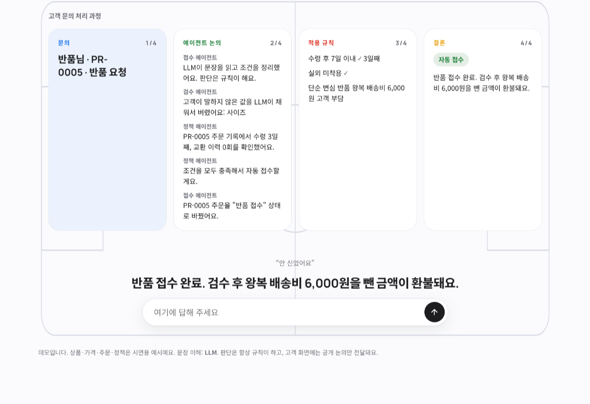
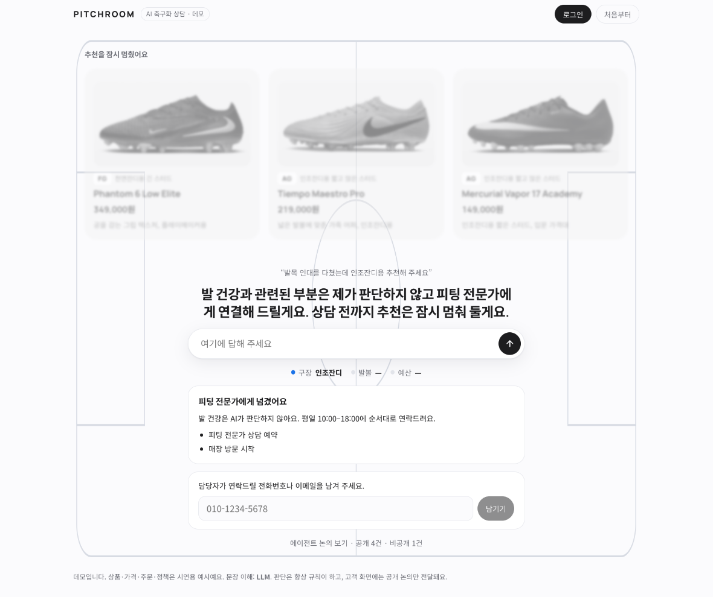
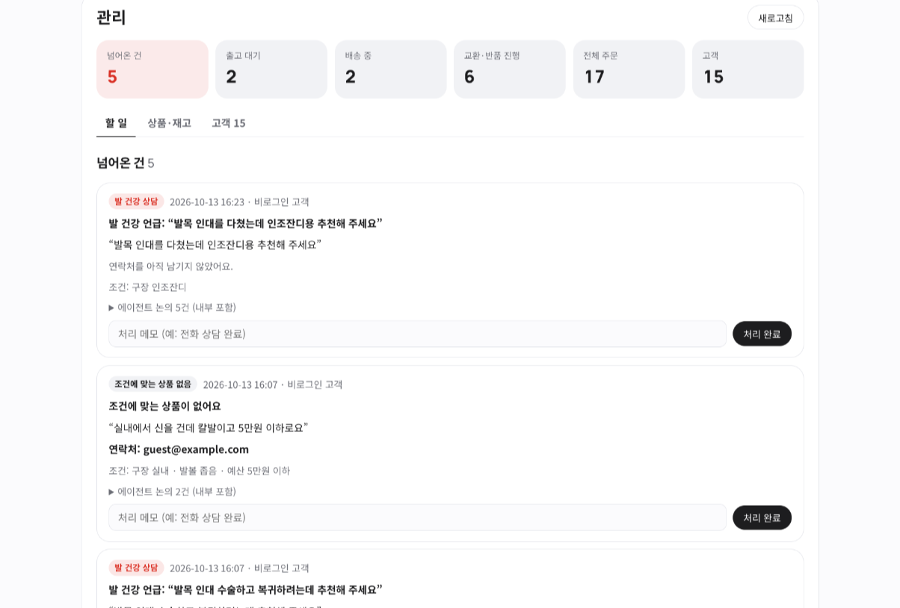
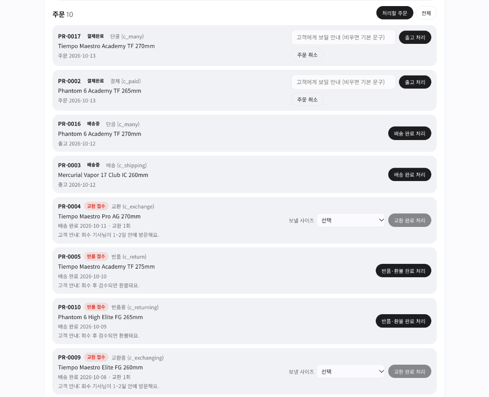
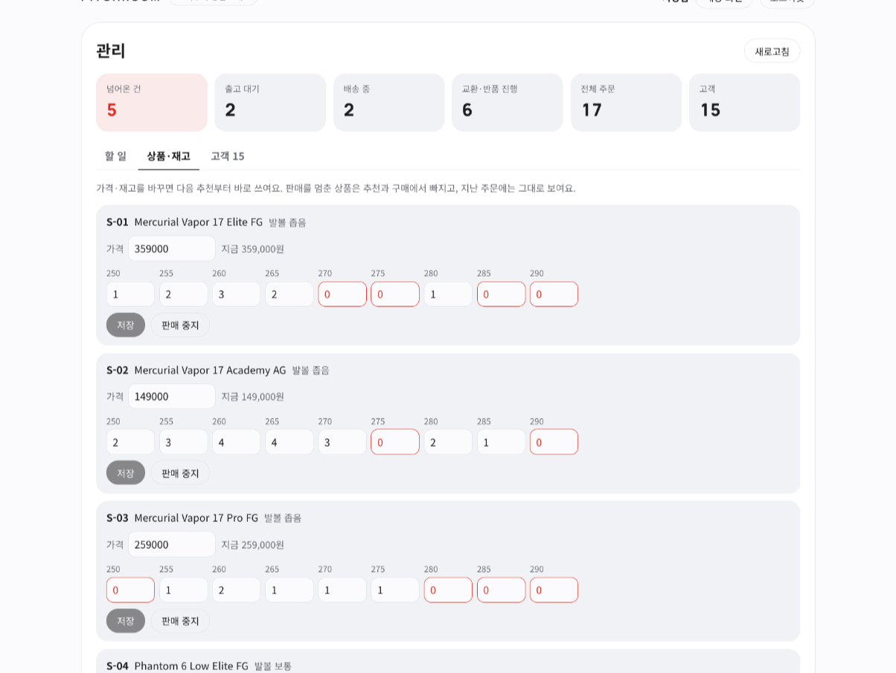
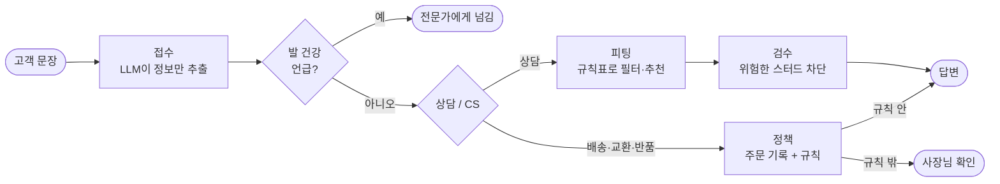
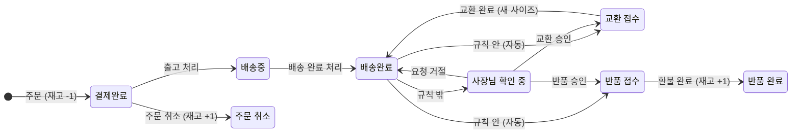

<div align="center">

# PITCHROOM

**AI 축구화 상담 · CS 에이전트**

문장은 LLM이 이해하고, 판단은 규칙이 합니다. 책임이 걸린 건은 사람에게 넘깁니다.




</div>

축구화 온라인 매장의 **구매 상담**과 **주문 후 고객응대**(배송·교환·반품)를 LangGraph 그래프 하나로 처리하는 웹 앱입니다. 고객은 대화로 상담하고 주문하며, 사장님은 관리 화면에서 넘어온 건과 주문·재고를 처리합니다.

> 상품·가격·주문·정책은 모두 시연용 데이터입니다. 상품 사진도 시연용이라, 외부에 공개할 때는 직접 촬영하거나 사용 허가를 받은 이미지로 바꿔야 합니다.

## 목차

- [시연 화면](#시연-화면)
- [어떻게 판단하나](#어떻게-판단하나)
- [빠른 시작](#빠른-시작)
- [계정과 관리 화면](#계정과-관리-화면)
- [케이스별 연습 계정](#케이스별-연습-계정)
- [운영 설정](#운영-설정)
- [구조](#구조) · [API](#api)
- [알려진 한계](#알려진-한계) · [다음 단계](#다음-단계)

## 시연 화면

### 고객: 상담하고 주문하기

<table>
<tr>
<td width="50%" valign="top">

<p align="center"><b>① 질문 하나로 시작</b><br>답할수록 뒤에 있는 축구화 3켤레가 선명해집니다.</p>
</td>
<td width="50%" valign="top">

<p align="center"><b>② 규칙이 고른 3켤레</b><br>딱 맞는 것이 부족하면 무엇을 양보했는지 함께 보여 줍니다.</p>
</td>
</tr>
<tr>
<td width="50%" valign="top">

<p align="center"><b>③ 주문한 고객의 첫 화면</b><br>가장 급한 주문부터 먼저 말을 겁니다.</p>
</td>
<td width="50%" valign="top">

<p align="center"><b>④ 교환·반품 처리 과정</b><br>문의, 에이전트 논의, 적용 규칙, 결론을 카드 4장으로 보여 줍니다.</p>
</td>
</tr>
</table>

### 사람에게 넘기기

<table>
<tr>
<td width="50%" valign="top">

<p align="center"><b>⑤ 발 건강은 AI가 판단하지 않습니다</b><br>추천을 멈추고 전문가에게 넘긴 뒤, 연락받을 곳을 묻습니다.</p>
</td>
<td width="50%" valign="top">

<p align="center"><b>⑥ 사장님 화면에 쌓이는 넘어온 건</b><br>고객 문장, 연락처, 내부 논의까지 한곳에서 봅니다.</p>
</td>
</tr>
</table>

### 사장님: 주문과 재고 관리

<table>
<tr>
<td width="50%" valign="top">

<p align="center"><b>⑦ 주문을 다음 단계로</b><br>출고, 배송 완료, 교환·반품 승인과 완료, 주문 취소.</p>
</td>
<td width="50%" valign="top">

<p align="center"><b>⑧ 가격과 사이즈별 재고</b><br>바꾼 값은 다음 추천부터 바로 쓰입니다.</p>
</td>
</tr>
</table>

## 어떻게 판단하나



| 원칙 | 구현 |
|---|---|
| 정확한 판단은 규칙으로 | 구장→스터드, 예산, 발볼, 교환·반품 기간은 `data.py` 표와 `tools.py` 함수로 판단 |
| AI 실수에 대비한 길 | 발 건강 언급 → 전문가, 후보 0개 → 대안 3켤레, 정책 밖 → 사장님, LLM 실패 → 키워드 규칙, LLM이 지어낸 값 → `ground_check`로 제거 |
| 내부 정보는 서버에서 차단 | 매입가·결재 기준 같은 내부 논의는 고객 화면 응답에 실리지 않고, 관리자만 봅니다 |
| 단순하게 시작 | 순서가 정해진 워크플로. '에이전트'는 역할별 노드 |
| 측정 가능한 개선 | `python -m pitchroom.evaluation` (Colab 실측: 위험 추천 MVP 5/8 → 개선 0/8, 에스컬레이션 2/4 → 4/4, 불필요한 에스컬레이션 4/13 → 0/13) |

## 빠른 시작

Python 3.10 이상, Node.js 20 이상이 필요합니다. Docker만 쓸 거라면 Docker만 있으면 됩니다.

```bash
make install   # 가상환경 + 파이썬/프론트 의존성, .env 생성
make dev       # 개발: http://127.0.0.1:5173  (API는 8000, 둘 다 자동 반영)
make start     # 화면을 빌드해 한 프로세스로 실행: http://127.0.0.1:8000
make docker    # Docker로 실행 (운영 설정): http://127.0.0.1:8000
```

`.env`에 `OPENAI_API_KEY`를 넣으면 LLM이 문장을 이해합니다. **키가 없어도 실행됩니다** (문장 이해만 키워드 규칙으로 바뀜).

| 하고 싶은 것 | 명령 |
|---|---|
| 웹 화면 (Vue + FastAPI) | `make dev` 또는 `make start` |
| Docker 실행 / 로그 / 중지 | `make docker` / `make docker-logs` / `make docker-down` |
| 테스트 (pytest + 타입 검사 + vitest) | `make test` |
| 케이스별 연습 계정 만들기·되돌리기 | `make sample` (Docker: `make docker-sample`) |
| 데모 계정·주문 처음 상태로 | `make reset-demo` |
| 터미널에서 대화 | `python -m pitchroom.cli` / `--user jiwoo` |
| 데모 대화 출력 | `python -m pitchroom.demo` |
| 평가 (MVP vs 개선) | `python -m pitchroom.evaluation` |
| 예전 Gradio 화면 | `python -m pitchroom.ui` → http://127.0.0.1:7860 |

대화·계정·주문은 `pitchroom.db`(SQLite, Docker에서는 `pitchroom-data` 볼륨)에 저장돼 새로고침하거나 서버를 다시 띄워도 이어집니다.

## 계정과 관리 화면

| 누구 | 어떻게 들어가나 | 무엇을 하나 |
|---|---|---|
| 고객 | 화면의 **회원가입** (아이디·이름·비밀번호 8자 이상) | 상담, 주문, 배송·교환·반품 문의 |
| 사장님 | 아이디 `admin` + 비밀번호 | **관리 화면**: 넘어온 건 확인, 주문 상태 넘기기, 가격·재고 관리, 고객 임시 비밀번호 |
| 데모 계정 4개 | 비밀번호 없이 아이디 클릭 (개발 모드에서만) | 정해진 주문 상황 시연 |

**관리자 비밀번호**는 `.env`의 `PITCHROOM_ADMIN_PASSWORD`로 정합니다. 비워 두면 처음 실행할 때 임시 비밀번호를 만들어 **서버 로그에 한 번** 보여 줍니다 (`make docker-logs` 또는 터미널 출력).

### 주문이 흘러가는 길



고객의 요청(교환·반품)은 에이전트가 규칙으로 판단하고, 나머지 화살표는 사장님이 관리 화면에서 누릅니다. 고객 답변은 바뀐 상태를 바로 따릅니다.

### 기능별 설명

| 기능 | 동작 |
|---|---|
| 넘어온 건 | 발 건강 언급, 규칙 밖 교환·반품, 맞는 상품 없음이 관리 화면 목록에 쌓입니다. 고객 문장, 적용 규칙, 에이전트 논의(내부 포함)를 함께 봅니다 |
| 연락처 | 사람에게 넘어간 건이면 고객 화면이 전화번호나 이메일을 묻습니다. 로그인한 고객은 한 번 남기면 다시 묻지 않습니다 |
| 알림 | `.env`의 `PITCHROOM_NOTIFY_WEBHOOK`에 Slack·Discord 웹훅 주소를 넣으면 넘어온 건과 새 주문을 알려 줍니다. 고객이 쓴 문장은 보내지 않고 종류와 주문 번호만 보냅니다 |
| 재고 | 사이즈별 수량이 DB에 있습니다. 주문하면 한 켤레 줄고(마지막 한 켤레가 두 번 팔리지 않음), 반품 완료·주문 취소 때 돌아오며, 교환 완료 때는 사장님이 고른 새 사이즈로 바뀝니다. 품절 사이즈는 구매 화면에 나오지 않습니다 |
| 가격·판매 여부 | 관리 화면 *상품·재고* 탭에서 바꾸면 다음 추천부터 바로 쓰입니다. 판매를 멈춘 상품은 추천과 구매에서 빠집니다 |
| 주문 취소 | 출고 전(결제완료) 주문은 관리 화면에서 취소할 수 있습니다. 고객이 대화로 직접 취소하는 기능은 없습니다 |
| 비밀번호 | 고객은 *내 주문* 패널에서 바꿀 수 있고, 잊었으면 사장님이 *고객* 탭에서 임시 비밀번호를 만들어 전해 줍니다 |

## 케이스별 연습 계정

`make sample`(Docker는 `make docker-sample`)은 **상황 하나에 계정 하나**를 만들고, 공통 비밀번호를 출력합니다. 로그인해서 아래 말을 치면 그 케이스가 재현됩니다. 다시 실행하면 연습 계정만 처음 상태로 되돌리고, 가입한 고객과 재고는 그대로 둡니다.

| 아이디 | 상황 | 해 볼 말 | 결과 |
|---|---|---|---|
| `c_new` | 주문 없음 | 인조잔디에서 뛰어요 → 발볼 넓어요 → 20만원 | 추천 3켤레, 구매 |
| `c_paid` | 결제완료, 출고 대기 | 언제 와요? / 교환하고 싶어요 | 출고 준비 중 / 배송 완료 후 신청 안내 |
| `c_shipping` | 배송중 | 어디쯤이에요? | 배송 중 안내 (도착일은 약속하지 않음) |
| `c_exchange` | 배송완료 2일째 | 사이즈가 작아요 → 실내에서만 신어봤어요 | 교환 자동 접수 |
| `c_return` | 배송완료 3일째 | 반품하고 싶어요 → 안 신었어요 | 반품 자동 접수 |
| `c_worn` | 배송완료 3일째, 착용함 | 교환하고 싶어요 → 경기 뛰었어요 | 사장님 확인으로 넘어감 |
| `c_late` | 배송완료 12일째 | 교환하고 싶어요 | 기한이 지나 사장님 확인, 연락처를 물어봄 |
| `c_again` | 이미 한 번 교환함 | 사이즈가 작아요 → 안 신었어요 | 무료 교환 1회 초과로 사장님 확인 |
| `c_exchanging` | 교환 접수됨 | 교환하고 싶어요 | 중복 접수하지 않고 진행 상태 안내 |
| `c_returning` | 반품 접수됨 | 반품 어떻게 됐어요? | 진행 상태 안내 |
| `c_waiting` | 사장님 확인 중 | 교환 어떻게 됐어요? | 확인 중 안내 |
| `c_returned` | 반품 완료 | (로그인만) | 반품 완료 안내 |
| `c_cancelled` | 주문 취소됨 | 언제 와요? | 진행 중인 배송 없음 |
| `c_many` | 주문 4건이 섞임 | 언제 와요? / 교환하고 싶어요 | 가장 급한 주문부터 안내 |

위 15가지 흐름은 자동 테스트(키워드 규칙 모드)로 고정돼 있습니다. LLM 모드에서는 말을 다르게 하면 의도를 다르게 읽을 수 있습니다.

데모 계정(개발 모드, 비밀번호 없음)도 있습니다: `minsu` 결제 완료 · `jiwoo` 배송 완료 3일째 · `hyun` 배송 완료 10일째, 교환 이력 · `seoyeon` 교환 진행 중 + 배송 중. 날짜가 만든 날 기준이라 며칠 지나면 `make reset-demo`로 다시 만드세요.

## 운영 설정

`PITCHROOM_ENV=production`(Docker 기본값)이면 데모 계정과 `/api/docs`가 꺼집니다. 각 항목은 `.env.example`에 설명이 있습니다.

| 항목 | 기본값 | 설명 |
|---|---|---|
| 요청 제한 | 대화 20회/분, 주소 120회/분, 로그인·가입 10회/분 | 넘으면 429. LLM 비용과 비밀번호 대입을 막습니다 |
| `PITCHROOM_COOKIE_SECURE` | 개발 0, 운영 1 (compose는 0) | HTTPS 뒤에 둘 때 1로. HTTP에서 1이면 로그인이 유지되지 않습니다 |
| `PITCHROOM_DEMO` | 개발 1, 운영 0 | 비밀번호 없는 데모 계정 |
| 보안 헤더 | 항상 | CSP, `X-Frame-Options: DENY`, `nosniff` |
| 오래된 대화 | 30일 | 그동안 쓰지 않은 대화 기록은 시작할 때 지웁니다 |

밖에 공개할 때는 앞에 HTTPS 프록시(Caddy, nginx 등)를 두고 `PITCHROOM_COOKIE_SECURE=1`, `PITCHROOM_ADMIN_PASSWORD`, `PITCHROOM_SECRET`을 정하세요. compose는 기본으로 `127.0.0.1`에만 포트를 엽니다.

## 구조

```
pitchroom/
  config.py      .env 읽기 (API 키, 모델명, 서버 주소, DB 경로, 운영 설정)
  data.py        상품 정의, 구장→스터드 규칙표, 안전한 대체표, 정책, 데모 계정, 재고 시드
  extract.py     LLM 구조화 추출(Pydantic) + 키워드 대체 + ground_check(LLM이 지어낸 값 제거)
  tools.py       단일 책임 도구: 상품 필터, 대안 계산, 정책 판단, 주문 조회, 선수 검색(Tavily)
  graph.py       State, 노드 7개, 조건 분기, to_client(내부 논의 제거)
  views.py       State → 화면이 그대로 그릴 JSON (카드, 흐림 정도, 카드뉴스, 주문 단계)
  store.py       SQLite 저장소: 계정(비밀번호 해시), 주문과 상태 변경 규칙, 가격·재고, 넘어온 건, 데모 시드
  notify.py      웹훅 알림 (넘어온 건, 새 주문)
  api.py         FastAPI: 고객 API + 관리 API(/api/admin/*), 요청 제한, 보안 헤더, 사진·빌드된 화면 서빙
  sample.py      케이스별 연습 계정 만들기·되돌리기
  ui.py          예전 Gradio 화면
  evaluation.py  시나리오 17개, MVP vs 개선 비교표
  cli.py, demo.py
  static/images  상품 사진
frontend/        Vue 3 + TypeScript + Pinia (Vite). 판단 로직 없음: API가 준 화면 JSON만 그린다
  src/stores/session.ts   화면 상태와 API 호출
  src/stores/admin.ts     관리 화면 상태
  src/components/         진열대, 상품·주문 카드, CS 카드뉴스, 로그인·가입 패널, 구매 시트, 관리 화면
app.py           웹 서버 실행 (uvicorn)
web/index.html   처음 만든 HTML 데모 (참고용. 판단 로직이 JS로 따로 들어 있어 서버와 다를 수 있음)
tests/           pytest (그래프 규칙 + HTTP API)
docs/screenshots 이 문서의 시연 화면
Dockerfile, docker-compose.yml   화면 빌드 + 서버를 한 이미지로 (requirements.txt만 설치)
requirements-dev.txt             개발·평가·테스트용 추가 의존성
```

## API

브라우저 하나 = 서명된 세션 쿠키 하나 = 대화(thread) 하나. 모든 응답은 `{account, view}`이고, 오류는 `{error: {code, message}}`입니다. 문서(개발 모드): http://127.0.0.1:8000/api/docs

<details>
<summary>엔드포인트 목록</summary>

| 메서드 | 경로 | 내용 |
|---|---|---|
| GET | `/api/health` | 상태, 문장 이해 방식(LLM / 키워드 규칙) |
| GET | `/api/catalog` | 상품과 재고 있는 사이즈, 데모 계정, 정책 |
| GET | `/api/session` | 지금 대화의 화면 (새로고침 복원) |
| POST | `/api/chat` | `{text}` → 한 턴 진행 |
| POST | `/api/signup` | `{user_id, name, password}` 가입 후 바로 로그인 |
| POST | `/api/login` | `{user_id, password, keep?}` |
| POST | `/api/logout`, `/api/reset` | 새 대화 (reset은 로그인 유지) |
| POST | `/api/orders` | `{code, size}` 주문 (결제는 없음) |
| POST | `/api/contact` | `{contact}` 넘어간 건에 연락처 남기기 |
| POST | `/api/password` | `{current, new}` 비밀번호 변경 |
| GET | `/api/admin/board` | 관리자: 요약, 넘어온 건, 주문, 상품·재고, 고객 |
| POST | `/api/admin/orders/{id}/status` | 관리자: `{to, note?, new_size?}` 주문을 다음 단계로 |
| POST | `/api/admin/products/{code}` | 관리자: `{price?, active?, stock?}` |
| POST | `/api/admin/customers/{id}/reset-password` | 관리자: 임시 비밀번호 발급 |
| POST | `/api/admin/handoffs/{id}/resolve` | 관리자: `{note}` 넘어온 건 처리 완료 |

</details>

## 알려진 한계

- **결제가 없습니다.** 주문은 버튼 한 번으로 생깁니다. PG사 계정과 키가 있어야 붙일 수 있습니다.
- **추천은 재고를 보지 않습니다.** 규칙은 구장·발볼·예산으로만 고르고, 원하는 사이즈가 품절이면 카드에 표시만 합니다.
- **상품 추가는 코드에서 합니다.** 관리 화면은 가격·판매 여부·재고만 바꿉니다 (새 상품은 `data.py`와 사진이 필요).
- 고객이 대화 중에 말한 교환 희망 사이즈는 주문에 기록되지 않습니다. 교환 완료 때 사장님이 고릅니다.
- 비밀번호 재설정은 사장님을 거칩니다 (이메일 인증 없음). 관리자는 한 명입니다.
- 알림은 웹훅 하나입니다. 보내지 못하면 로그만 남기고 다시 시도하지 않습니다.
- 서버는 한 프로세스(워커 1개) 기준입니다. 요청 제한, 대화 잠금, 상품 목록이 프로세스 메모리에 있습니다.
- 발 건강 키워드는 부분 일치라 "아파트" 같은 단어도 전문가 연결로 갑니다 (`data.py`의 `RED_FLAGS`).
- 상품명·사진은 시연용입니다. 공개 전에 직접 촬영하거나 허가받은 이미지로 바꿔야 합니다.

## 다음 단계

- 결제 연동 (PG사 선택 후)
- 추천 단계에서 원하는 사이즈의 재고 반영, 관리 화면에서 상품 추가
- 이메일 인증과 셀프 비밀번호 재설정
- 대체 스터드 점수표를 축구화 전문가에게 검토받기
